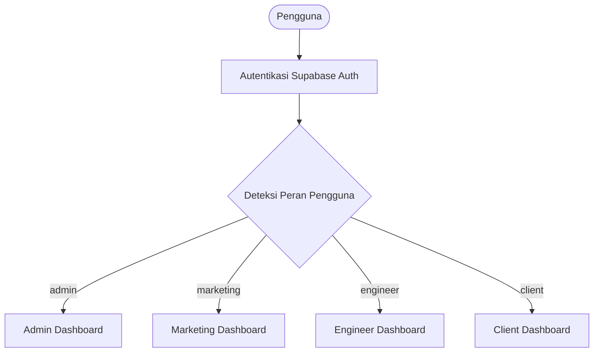
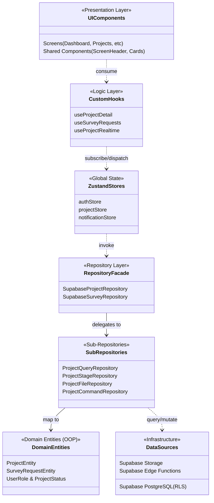
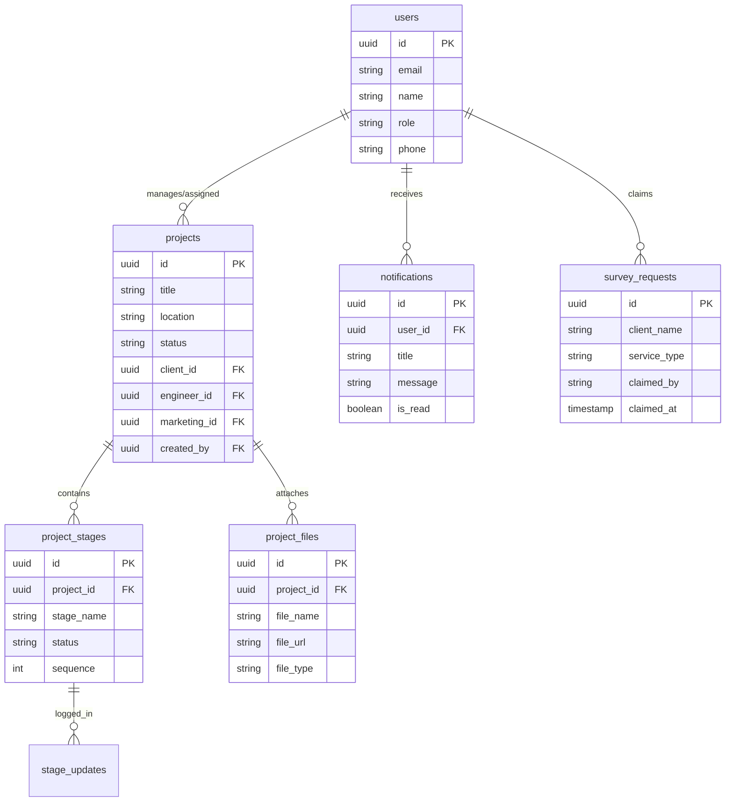

# Panduan Komprehensif Handover & Onboarding Pengembang - GSI One Mobile

Dokumen ini disusun sebagai panduan menyeluruh (*comprehensive onboarding guide*) untuk pengembang baru pada proyek **GSI One Mobile Application**. Dokumen ini merangkum domain bisnis, arsitektur teknis, aliran data, standar pengkodean, hingga prosedur operasional sistem.

---

## 1. Ikhtisar Sistem & Domain Bisnis

### 1.1 Profil Proyek
* **Nama Aplikasi**: GSI One
* **Pemilik Produk**: PT Graha Survei Indonesia (GSI)
* **Domain Industri**: Inspeksi Teknis Struktur, *Forensic Engineering*, *Non-Destructive Testing (NDT)*, *Structural Health Monitoring System (SHMS)*, dan Penilaian Kerentanan Bencana.
* **Versi Rilis Saat Ini**: `1.4.0` (Production Ready)
* **Model Distribusi**: Android APK/AAB (Google Play Store) & Web Responsive (via `react-native-web`).

### 1.2 Matriks Akses Pengguna (Role-Based Access Control)
Aplikasi beroperasi dengan 4 tingkatan peran (*role*) terisolasi:



| Hak Akses / Fitur | Tamu (Publik) | Klien (`client`) | Engineer (`engineer`) | Marketing (`marketing`) | Administrator (`admin`) |
| :--- | :---: | :---: | :---: | :---: | :---: |
| **Katalog Layanan & Profil GSI** | ✅ | ✅ | ✅ | ✅ | ✅ |
| **Pemesanan Survey Struktur** | ✅ | ✅ | ✅ | ✅ | ✅ |
| **Daftar Permohonan Survey** | ❌ | ❌ | ❌ | ✅ | ✅ |
| **Klaim / Follow-up Survey** | ❌ | ❌ | ❌ | ✅ | ✅ |
| **Pendaftaran Pengguna Baru** | ❌ | ❌ | ❌ | ❌ | ✅ *(Eksklusif)* |
| **Pembuatan Proyek Baru** | ❌ | ❌ | ❌ | ❌ | ✅ *(Eksklusif)* |
| **Update Tahapan & Unggah Berkas** | ❌ | ❌ | ✅ | ❌ | ✅ |
| **Monitoring Proyek Mandiri** | ❌ | ✅ *(Proyek Sendiri)* | ✅ *(Ditugaskan)* | ✅ *(Ditugaskan)* | ✅ *(Semua)* |
| **Pusat Notifikasi In-App** | ❌ | ✅ | ✅ | ✅ | ✅ |

> [!IMPORTANT]
> **Model Pendaftaran Akun Terpusat**: Pendaftaran akun publik telah dinonaktifkan demi privasi dan keamanan proyek teknis. Seluruh akun (termasuk Klien) didaftarkan secara terpusat oleh Admin melalui modal [AdminRegisterModal](src/screens/Dashboard/components/AdminRegisterModal.tsx) atau Supabase Edge Function [admin-create-user](supabase/functions/admin-create-user/index.ts).

---

## 2. Arsitektur Perangkat Lunak (Clean Architecture & OOP)

Codebase menganut pola **Clean Architecture & Layered Domain Design**:



### Penjelasan Lapisan Arsitektur:
1. **Presentation Layer (`src/screens/`, `src/components/`)**:
   - Komponen UI murni deklaratif yang terisolasi dari kueri langsung ke database.
   - Menggunakan token desain terpusat dari [Colors.tsx](assets/styles/Colors.tsx) dan utilitas tata letak [GlobalStyle.tsx](assets/styles/GlobalStyle.tsx).
2. **Logic & Hook Isolation Layer (`src/hooks/`)**:
   - Memisahkan *side-effects*, penanganan formulir, dan langganan WebSocket dari render tree UI.
   - Contoh: [useProjectDetail.ts](src/hooks/useProjectDetail.ts), [useSurveyRequests.ts](src/hooks/useSurveyRequests.ts), [useProjectRealtime.ts](src/hooks/useProjectRealtime.ts).
3. **State Management (`src/store/`)**:
   - Dikelola oleh Zustand v5: [authStore.ts](src/store/authStore.ts), [projectStore.ts](src/store/projectStore.ts), dan [notificationStore.ts](src/store/notificationStore.ts).
   - Mendukung pembaruan optimistik (*optimistic update*) dengan *rollback* otomatis jika mutasi ditolak oleh server/RLS.
4. **Repository Layer (`src/services/repositories/`)**:
   - [SupabaseProjectRepository.ts](src/services/repositories/SupabaseProjectRepository.ts) bertindak sebagai façade yang mendelegasikan tanggung jawab kepada sub-repository:
     - [ProjectQueryRepository.ts](src/services/repositories/sub/ProjectQueryRepository.ts): Kueri daftar proyek, detail, filtering, dan pagination.
     - [ProjectStageRepository.ts](src/services/repositories/sub/ProjectStageRepository.ts): Penambahan/perubahan tahapan dan catatan harian.
     - [ProjectFileRepository.ts](src/services/repositories/sub/ProjectFileRepository.ts): Pengunggahan berkas teknis dan pembuatan signed URL.
     - [ProjectCommandRepository.ts](src/services/repositories/sub/ProjectCommandRepository.ts): Pembuatan dan pembaruan data master proyek.
   - [projectMapper.ts](src/services/mappers/projectMapper.ts) memetakan raw row PostgreSQL ke instance model entitas.
5. **Domain Entities (`src/domain/`)**:
   - [ProjectEntity.ts](src/domain/entities/ProjectEntity.ts): Menyediakan kalkulasi bisnis mandiri seperti `getProgressPercentage()`, `isOverdue()`, dan `getFormattedBudget()`.
   - [SurveyRequestEntity.ts](src/domain/entities/SurveyRequestEntity.ts): Menyediakan method klaim dan generator URL pesan WhatsApp otomatis.

---

## 3. Database, Skema Data & Keamanan RLS

Database utama aplikasi berbasis PostgreSQL di **Supabase Cloud**.



### Aturan Keamanan PostgreSQL (Row Level Security - RLS):
1. **Otorisasi Berbasis UUID**:
   - Akses data proyek Klien diverifikasi berdasarkan `client_id = auth.uid()`.
   - Akses Field Engineer diverifikasi melalui `engineer_id = auth.uid() OR created_by = auth.uid()`.
2. **PostgreSQL Trigger `sync_user_name_changes`**:
   - Ketika nama Klien diubah di tabel `users`, trigger PostgreSQL secara otomatis mensinkronkan nilai `projects.client_name` agar riwayat akses data tidak terputus.
3. **Storage Bucket Privat `projects`**:
   - Bucket tidak dibuka ke publik (`public = false`).
   - Setiap foto progres dan dokumen NDT diakses menggunakan signed URL sementara berdurasi terukur via [storageService.ts](src/services/storageService.ts).
4. **Proteksi Mutasi Notifikasi**:
   - Pengguna dilarang melakukan `INSERT` notifikasi langsung dari client. Notifikasi hanya dibuat melalui trigger database atau Edge Function tepercaya.

---

## 4. Peta Struktur Direktori Codebase

Berikut referensi navigasi berkas terpenting di repository:

```
d:/fajar/GSI One - Copy/
├── assets/
│   └── styles/
│       ├── Colors.tsx              # Definisi token warna (roleColors, neutral, surface, overlay)
│       └── GlobalStyle.tsx         # Objek utilitas StyleSheet (Gs.h1, Gs.flexRow, Gs.cornerMD)
├── docs/                           # Dokumentasi SDLC, SRS, Architecture, & index.html portal
├── supabase/
│   ├── functions/admin-create-user # Edge function pendaftaran user via Service Role Key
│   └── migrations/                 # Migrasi SQL RLS, index, dan storage bucket
├── __tests__/                      # 15 Test Suite Jest (Domain, Services, Utils, Integration)
├── src/
│   ├── components/
│   │   ├── common/ScreenHeader.tsx # Header bersama dengan gradient dinamis per-role
│   │   ├── common/SupportCard.tsx  # Kartu kontak bantuan (telepon & situs GSI)
│   │   └── ErrorBoundary/          # Komponen penangkap crash render tree
│   ├── config/
│   │   └── supabase.ts             # Client SDK dan konfigurasi Supabase
│   ├── domain/
│   │   ├── entities/               # ProjectEntity.ts & SurveyRequestEntity.ts
│   │   └── enums/                  # UserRole.ts & ProjectStatus.ts
│   ├── hooks/
│   │   ├── useProjectDetail.ts     # Pengelola state & data tahapan proyek
│   │   ├── useSurveyRequests.ts    # Pengelola data survey & status klaim
│   │   ├── useProjectRealtime.ts   # Listener WebSocket Supabase
│   │   └── useRoleTheme.ts         # Hook resolusi tema warna aktif
│   ├── navigation/
│   │   └── AuthenticatedTabs.tsx   # Tab navigator bawah untuk Dashboard, Proyek, & Profil
│   ├── screens/
│   │   ├── Dashboard/              # Router dashboard peran & implementasi 4 role
│   │   ├── Projects/               # ProjectList, ProjectDetail, CreateProject, & Modals
│   │   ├── BookSurvey/             # Formulir reservasi survey & SurveyRequestsScreen
│   │   ├── Services/               # Katalog 6 layanan resmi GSI & LayananDetailScreen
│   │   └── Profile/                # Layar profil pengguna & edit profil
│   ├── services/
│   │   ├── repositories/           # SupabaseProjectRepository & sub-repositories
│   │   ├── storageService.ts       # Generator signed URL berkas privat
│   │   └── notificationService.ts  # Layanan pagination & update status notifikasi
│   ├── store/
│   │   ├── authStore.ts            # State sesi pengguna & caching AsyncStorage
│   │   ├── projectStore.ts         # State daftar proyek & selector granular
│   │   └── notificationStore.ts    # State notifikasi & optimistic mutation
│   └── utils/
│       ├── formatters.ts           # Format tanggal (formatDateDisplay) & rupiah (formatCurrency)
│       ├── responsive.ts           # Scaling responsive UI (scale, fontScale, wp, hp)
│       └── errorHelpers.ts         # Normalisasi pesan error terpusat (getErrorMessage)
├── App.tsx                         # Entry point aplikasi mobile & Root Stack
├── CODEBASE_MAP.md                 # Dokumentasi navigasi detail per berkas
├── HANDOVER.md                     # Ringkasan operasional serah terima
└── package.json                    # Manifes paket & script npm
```

---

## 5. Standar Pengkodean (*Coding Standards*)

Untuk mempertahankan integritas kode dan kualitas lulusan CI/CD:

1. **Strict TypeScript (Zero `any`)**:
   - Hindari casting tipe `as any`. Semua tipe data respons database wajib menggunakan definisi di [src/types/database.types.ts](src/types/database.types.ts) atau kelas domain entity.
2. **Gunakan Helper Terpusat**:
   - Format Tanggal & Mata Uang: Gunakan fungsi `formatDateDisplay()`, `formatDateDb()`, atau `formatCurrency()` dari [src/utils/formatters.ts](src/utils/formatters.ts).
   - Penanganan Error: Bungkus pesan error catch block dengan `getErrorMessage(error, 'Pesan default')` dari [src/utils/errorHelpers.ts](src/utils/errorHelpers.ts).
   - Dimensi Responsif: Gunakan `scale()`, `fontScale()`, `wp()`, dan `hp()` dari [src/utils/responsive.ts](src/utils/responsive.ts).
3. **Konsistensi Tema Role**:
   - Selalu ambil warna tema menggunakan hook `useRoleTheme()` dari [src/theme/roleTheme.ts](src/theme/roleTheme.ts) agar elemen UI otomatis mengikuti role pengguna aktif.
4. **Isolasi Repository**:
   - Dilarang keras menuliskan query PostgREST `supabase.from(...)` di file UI screen/komponen. Logika data wajib ditempatkan di [src/services/repositories/](src/services/repositories).

---

## 6. Pengujian & Penjaminan Kualitas (Quality Assurance)

Seluruh test suite Jest telah diuji dan terverifikasi **100% lulus (74 tests passed)**:

| Test Suite | File | Cakupan Pengujian |
| :--- | :--- | :--- |
| **User Role & Enums** | `UserRole.test.ts` | Validasi peran, konversi string, dan guard |
| **Storage Service** | `storageService.test.ts` | Validasi signed URL generation & fallback |
| **Entity OOP** | `ProjectEntity.test.ts`, `SurveyRequestEntity.test.ts` | Validasi persentase progres, budget, dan claim WA |
| **Mappers & DTO** | `projectMapper.test.ts` | Pemetaan eksplisit field Supabase row ke model proyek |
| **Formatters & Utils** | `formatters.test.ts`, `responsive.test.ts`, `errorHelpers.test.ts` | Format rupiah, tanggal, scaling, dan parsing error |
| **Notification Service**| `notificationService.test.ts` | Validasi pagination, deteksi RLS error, dan rollback |
| **Project Integration** | `projectFlow.test.ts`, `projectPagination.test.ts`, `rlsMatrix.test.ts` | Simulasi end-to-end integrasi data proyek dan pagination |
| **Root Application** | `App.test.tsx` | Verifikasi render awal root component |

---

## 7. Status Fitur & Rencana Pengembangan Mendatang (Roadmap)

### Fitur yang Sudah Berjalan Stabil:
- [x] Autentikasi Supabase & pemulihan sesi otomatis via `AsyncStorage`.
- [x] RBAC 4 Role dengan routing dashboard otomatis.
- [x] Pendaftaran pengguna terpusat oleh Admin via modal & Edge Function.
- [x] Siklus hidup proyek: pembuatan master, penugasan, timeline vertikal, log catatan, dan upload dokumen teknis.
- [x] Storage bucket privat dengan penandatanganan URL sementara (*Signed URLs*).
- [x] Permohonan survey struktur dengan fitur klaim Marketing & notifikasi WhatsApp otomatis.
- [x] Integrasi WebSocket realtime untuk sinkronisasi proyek dan status tahapan.

### Roadmap Fitur yang Belum Selesai (Pending Tasks):
1. **Push Notifications (FCM / OneSignal Integration)**:
   - *Status*: Belum Selesai.
   - *Rencana*: Menghubungkan Firebase Cloud Messaging (FCM) agar notifikasi proyek dapat diterima di latar belakang (*background state*) saat ponsel terkunci.
2. **Automated Server Cron / Scheduled Edge Function**:
   - *Status*: Belum Selesai.
   - *Rencana*: Menjadwalkan fungsi serverless untuk mendeteksi proyek yang mendekati tanggal jatuh tempo (*overdue alert*) secara otomatis.
3. **Database Audit Logs Table (`audit_logs`)**:
   - *Status*: Belum Selesai.
   - *Rencana*: Menyediakan tabel audit trails untuk merekam riwayat penghapusan dokumen teknis dan perubahan tahapan penting.
4. **Offline Synchronization Engine (Offline-First)**:
   - *Status*: Belum Selesai.
   - *Rencana*: Menerapkan antrean mutasi lokal (*offline mutation queue*) agar Engineer tetap dapat mencatat progres saat berada di lokasi proyek terpencil tanpa sinyal internet.

---

## 8. Panduan Menjalankan Lingkungan Pengembangan (Developer Quickstart)

### 8.1 Prasyarat Perangkat Lunak
- **Node.js**: Versi `20.x` LTS atau lebih baru
- **JDK**: OpenJDK 17
- **Android Studio**: Android SDK Platform 36, Build-Tools 36.0.0, NDK 27.1.12297006 (sesuai `android/build.gradle`)
- **Package Manager**: npm v10+

### 8.2 Konfigurasi Lingkungan (`.env`)
Salin template berkas konfigurasi:
```powershell
cp .env.example .env
```
Pastikan kunci berikut telah terkonfigurasi:
```env
SUPABASE_URL=https://your-project.supabase.co
SUPABASE_ANON_KEY=your-anon-key
```

### 8.3 Perintah Operasional Harian
```powershell
# 1. Menjalankan Metro Bundler
npm run start

# 2. Menjalankan Aplikasi di Android Emulator / Device
npm run android

# 3. Menjalankan Versi Web (debugging cepat di browser Chrome/Edge)
npm run web

```

### 8.4 Quality Gate Check (Wajib sebelum Commit)
```powershell
# Validasi Tipe Data TypeScript (Wajib 0 error)
npm run typecheck

# Validasi Linter ESLint
npm run lint

# Menjalankan Seluruh Unit & Integration Test
npm test
```
