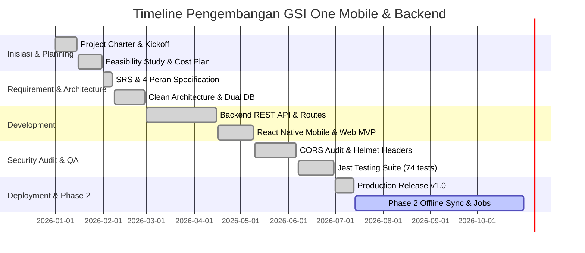

# Project Management Plan
## Proyek: GSI One Mobile Application & Backend Infrastructure

---

## 1. Milestone Utama Proyek

| No | Milestone                        | Target Tanggal | Status   | Catatan Audit / Scope |
| -- | -------------------------------- | -------------- | -------- | --------------------- |
| 1  | Project Charter Disetujui        | 2026-01-15     | Selesai  | Scope awal & otorisasi tim |
| 2  | Requirements Specification Final | 2026-02-07     | Selesai  | Spesifikasi 4 Role & Alur Bisnis |
| 3  | Architecture Design Disetujui    | 2026-02-28     | Selesai  | Dual-DB (SQLite Dev & Supabase Prod) |
| 4  | Backend Express & Security API   | 2026-04-15     | Selesai  | CORS audit, Helmet, Rate Limiting, JWT Auth |
| 5  | MVP Build Pertama (Alpha)        | 2026-05-09     | Selesai  | React Native Mobile & Web |
| 6  | Internal & Security Audit        | 2026-06-06     | Selesai  | Audit RLS Supabase & CORS Whitelist |
| 7  | UAT & Testing per Role           | 2026-06-30     | Selesai  | Admin, Marketing, Engineer, Client |
| 8  | Production Release v1.0          | 2026-07-13     | Selesai  | Live App & REST API |
| 9  | Phase 2: Offline Sync & Advanced Jobs | 2026-10-31 | Terencana | Peningkatan background sync & offline cache |

---

## 2. Resource Plan & Alokasi Peran

| Peran             | Jumlah | Alokasi | Tanggung Jawab Utama |
| ----------------- | ------ | ------- | --------------------- |
| Project Manager   | 1      | 20%     | Pengawasan milestone, jadwal, dan komunikasi stakeholder |
| Lead Developer    | 1      | 100%    | Arsitektur backend Express, Supabase RLS, dan integrasi API |
| Mobile Developer  | 2      | 100%    | Frontend React Native (Android, iOS, Web) & Zustand Store |
| QA & Security Eng | 1      | 50%     | Audit CORS, Helmet security headers, dan pengujian Jest |
| UI/UX Designer    | 1      | 50%     | Design tokens terpusat & sistem warna berbasis role |

---

## 3. Scope & Komponen Teknologi Terintegrasi

1. **Frontend Mobile & Web**:
   - React Native 0.83, TypeScript, `@react-navigation` (Native Stack & Bottom Tabs).
   - Zustand untuk manajemen state global (`authStore`, `projectStore`).
   - Client Supabase SDK & HTTP REST Client (`src/config/api.ts`).

2. **Backend API & Sub-Sistem Keamanan**:
   - Node.js & Express.js server (`server.js`).
   - Modul Rute: Auth (`authRoutes`), Projects (`projectRoutes`), Bookings (`bookingRoutes`), Files (`fileRoutes`), Notifications (`notificationRoutes`).
   - Keamanan: Penguncian CORS Origin (`https://grahasurvei.com`, `http://localhost:3000`, `http://10.0.2.2:3000`), `helmet()` HTTP security headers, JWT secret verification, rate-limiting.

3. **Database Dual-Layer**:
   - SQLite (`gsi_one.db`) via `backend/database.js` untuk isolasi pengujian lokal.
   - Supabase PostgreSQL Cloud via `backend/supabase_schema.sql` dengan 7 tabel utama (`users`, `bookings`, `projects`, `project_stages`, `stage_updates`, `project_files`, `notifications`) yang dilindungi Row Level Security (RLS).

---

## 4. Manajemen Risiko Utama

| Risiko                        | Dampak | Probabilitas | Mitigasi |
| ----------------------------- | ------ | ------------ | -------- |
| Penolakan Request CORS        | Tinggi | Sedang       | Menambahkan whitelist origin resmi dan mekanisme error callback terisolasi |
| Kegagalan Akses File Storage  | Tinggi | Rendah       | Implementasi Signed URL Supabase Storage dengan durasi kadaluarsa aman |
| Kebocoran JWT Secret          | Tinggi | Rendah       | Validasi wajib `JWT_SECRET` pada startup server `server.js` |
| Sinkronisasi Nama Pengguna    | Sedang | Sedang       | Database Trigger `sync_user_name_changes` pada tabel PostgreSQL |

---

## 5. Proses Manajemen Perubahan (Change Control Process)

Setiap perubahan scope, endpoint API, atau skema database wajib melalui:
1. Pengajuan Change Request (CR) tertulis.
2. Impact Analysis oleh Lead Developer dan QA (memeriksa kompatibilitas RLS & CORS).
3. Evaluasi dan persetujuan Project Manager sebelum deploy ke environment produksi.

---

## 6. Diagram Timeline Milestone (Gantt Chart)

