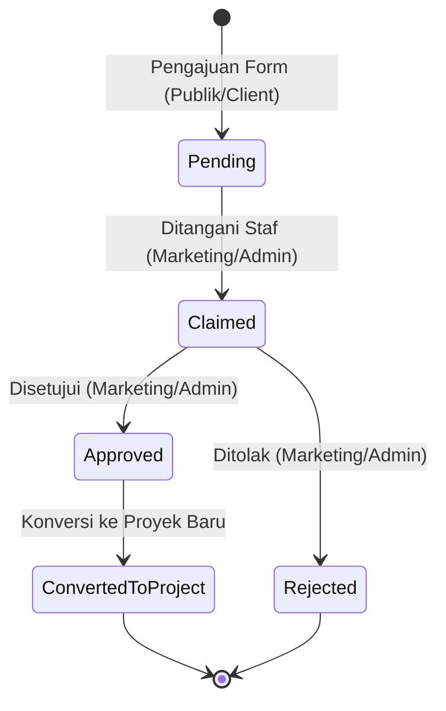
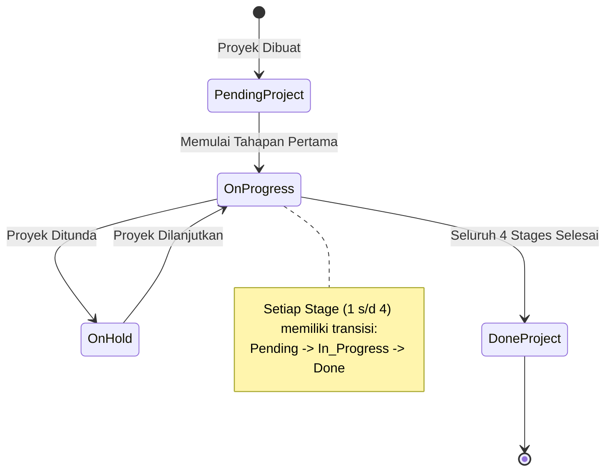

# Software Requirement Specification (SRS)
## Proyek: GSI One Mobile Application & Supabase
## Standar: ISO/IEC/IEEE 29148

---

## 1. Pendahuluan

### 1.1 Tujuan
Dokumen ini mendeskripsikan persyaratan fungsional dan non-fungsional untuk aplikasi **GSI One** (React Native & Supabase) yang digunakan oleh PT Graha Survei Indonesia dalam memfasilitasi pemesanan survei, pelacakan proyek teknis, manajemen berkas inspeksi, dan notifikasi otomatis.

### 1.2 Lingkup Produk
GSI One menyediakan ekosistem terpadu berbasis 4 Peran Pengguna:
- **Admin**: Pembuat akun pengguna, pengelola seluruh proyek, booking, dan berkas.
- **Marketing**: Pengelola permohonan survei (klaim, setuju, tolak) dan pemantau proyek.
- **Engineer (Field Engineer)**: Pembaru status tahapan linimasa proyek, pencatat harian (*stage updates*), dan pengunggah dokumen/foto inspeksi.
- **Client**: Pemantau progres proyek real-time dan pengunduh berkas laporan resmi.

### 1.3 Definisi, Akronim, dan Singkatan
- **GSI**: PT Graha Survei Indonesia, perusahaan penyedia jasa audit struktur, NDT, dan monitoring bangunan.
- **SRS**: Software Requirements Specification (Spesifikasi Persyaratan Perangkat Lunak).
- **SHMS**: Structural Health Monitoring System (Sistem Pemantauan Kesehatan Struktur).
- **EEWS**: Early Earthquake Warning System (Sistem Peringatan Dini Gempa Bumi).
- **NDT / DT**: Non-Destructive Testing / Destructive Testing (Pengujian Non-Destruktif dan Destruktif).
- **RLS**: Row Level Security (Kebijakan Keamanan Tingkat Baris pada Supabase PostgreSQL).
- **AsyncStorage**: Penyimpanan data key-value lokal pada React Native untuk persistensi token autentikasi dan profil pengguna.
- **Zustand**: Library manajemen state global yang digunakan pada aplikasi (`authStore`, `projectStore`).
- **CORS**: Cross-Origin Resource Sharing (Mekanisme keamanan HTTP untuk membatasi origin web yang diizinkan pada Edge Function).
- **JWT**: JSON Web Token (Standar enkripsi token untuk autentikasi dan otorisasi sesi pengguna).
- **RBAC**: Role-Based Access Control (Sistem pengontrolan hak akses terstruktur berdasarkan 4 peran: Admin, Marketing, Engineer, dan Client).
- **DTO**: Data Transfer Object (Pola objek pemetaan data terisolasi antara skema database dan entitas domain aplikasi via `projectMapper.ts`).
- **REST API**: Representational State Transfer Application Programming Interface (Antarmuka komunikasi HTTP terstruktur berbasis JSON).
- **BaaS**: Backend as a Service (Platform cloud backend terintegrasi Supabase untuk Database PostgreSQL, Auth, Realtime, dan Storage).
- **Signed URL**: URL akses berdurasi terbatas yang diterbitkan oleh Supabase Storage untuk mengunduh dokumen dari bucket privat `projects`.
- **Stage Updates**: Catatan harian aktivitas kemajuan pekerjaan proyek di lapangan yang diinput oleh Field Engineer.
- **Project Stages**: 4 tahapan linimasa standar dalam proyek GSI One (Inisiasi, Survei Lapangan, Analisis & Laporan, Selesai).
- **SLO**: Service Level Objective (Target tingkat kualitas performa layanan aplikasi mencakup latensi, error rate, dan availability).

---

## 2. Persyaratan Fungsional (Functional Requirements)

### 2.1 Modul Autentikasi & Otorisasi (`FR-AUTH`)
- **FR-AUTH-01**: Sistem harus menyediakan login berbasis JWT Token & Supabase Auth.
- **FR-AUTH-02**: Registrasi akun baru hanya dapat dilakukan oleh **Admin** (Admin-Only Registration) demi menjaga keamanan data proyek.
- **FR-AUTH-03**: Sistem harus menerapkan Role-Based Access Control (RBAC) pada level aplikasi dan database (RLS).

### 2.2 Modul Pemesanan Survei & Booking (`FR-BOOK`)
- **FR-BOOK-01**: Pengguna publik/klien dapat mengajukan permohonan survei lokasi dengan mengisi data lengkap.
- **FR-BOOK-02**: Tim Marketing/Admin dapat mengklaim status booking (`pending` -> `claimed`), menyetujui (`approved`), atau menolak (`rejected`).
- **FR-BOOK-03**: Booking berstatus `approved` dapat secara otomatis dikonversi menjadi proyek teknis baru.

### 2.3 Modul Tracking Proyek & Stages (`FR-PROJ`)
- **FR-PROJ-01**: Proyek baru dibuat dengan 4 tahapan standar (Inisiasi, Survei Lapangan, Analisis & Laporan, Selesai).
- **FR-PROJ-02**: Field Engineer & Admin dapat memperbarui persentase progres total dan status per tahapan.
- **FR-PROJ-03**: Setiap pembaruan aktivitas harian dicatat ke tabel `stage_updates`.

### 2.4 Modul Manajemen Berkas & Dokumen (`FR-DOC`)
- **FR-DOC-01**: Field Engineer & Admin dapat mengunggah berkas/foto inspeksi (format PDF/Gambar, maks 10MB).
- **FR-DOC-02**: Berkas tersimpan secara aman di Supabase Storage privat dan hanya dapat diakses melalui Signed URL terotentikasi.

### 2.5 Modul Notifikasi & Event (`FR-NOTIF`)
- **FR-NOTIF-01**: Sistem mengirim notifikasi berbasis `user_id` atau `target_role` saat terjadi pembaruan status booking atau proyek.

---

## 3. Persyaratan Non-Fungsional (Non-Functional Requirements)

### 3.1 Keamanan & Networking (`NFR-SEC`)
- **NFR-SEC-01 (CORS)**: Edge Function membatasi origin web ke situs resmi dan localhost:8080 untuk development.
- **NFR-SEC-03 (RLS)**: Row Level Security (RLS) PostgreSQL aktif untuk semua tabel Supabase.

### 3.2 Performa & Skalabilitas (`NFR-PERF`)
- **NFR-PERF-01**: Waktu respons REST API rata-rata < 300ms.
- **NFR-PERF-02**: Pagination terimplementasi pada listing proyek & notifikasi untuk efisiensi memori.

---

## 4. Diagram Transisi Status (State Machine Diagrams)

### 4.1 State Machine Alur Status Booking Survei (`bookings.status`)

### 4.2 State Machine Alur Status Proyek & Stage (`projects.status` & `project_stages.status`)

