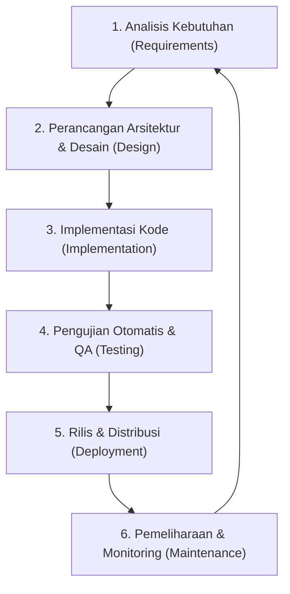
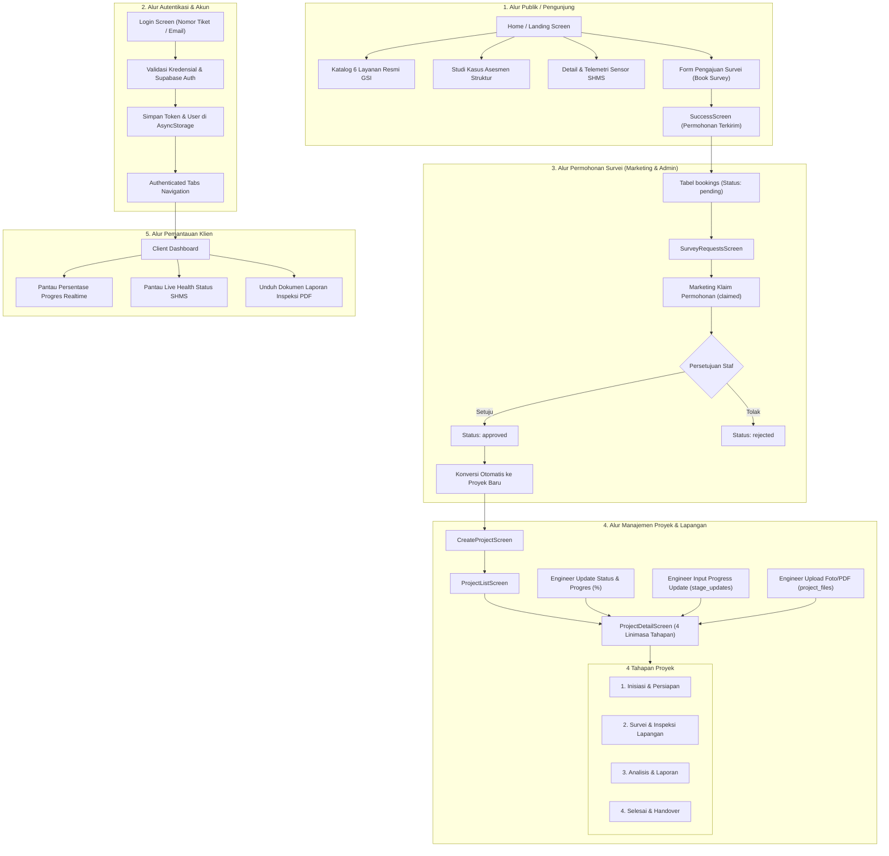
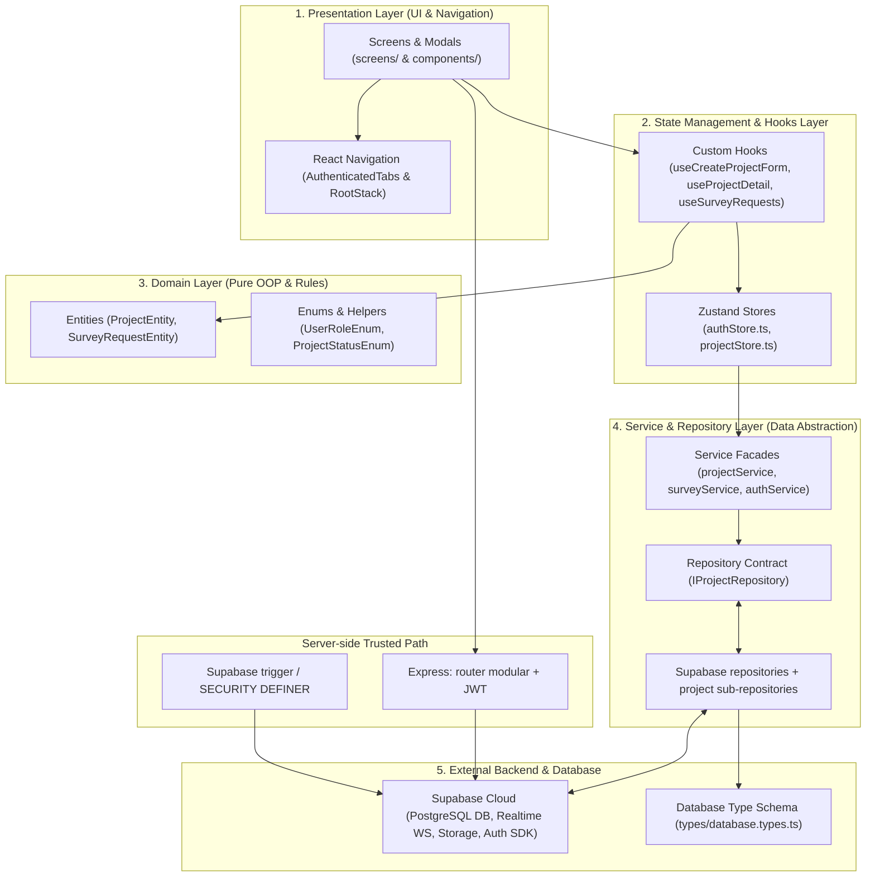

# Arsitektur Sistem, Alur Aplikasi, & Alur Kerja SDLC
## Proyek: GSI One Mobile Application

---

## 1. Alur Kerja SDLC (Software Development Life Cycle)

Pengembangan aplikasi **GSI One** mengadopsi model **Agile/Iterative SDLC** yang menekankan fleksibilitas, pengiriman fungsionalitas secara berkala, pengujian otomatis, dan peningkatan kualitas berkelanjutan. Alur kerja pengembangan dibagi menjadi enam tahapan utama:

### Detail Tahapan SDLC:

1. **Analisis Kebutuhan (Requirements Analysis)**:
   Mengumpulkan kebutuhan bisnis dari PT Graha Survei Indonesia, mengidentifikasi 4 peran pengguna (Admin, Marketing, Engineer, Client), mendefinisikan skenario penggunaan aplikasi, serta menyusun dokumen Software Requirements Specification (SRS).

2. **Perancangan Arsitektur & Desain (System & UI Design)**:
   Merancang arsitektur berlapis (*Clean Architecture*), skema navigasi stack aplikasi, state management dengan Zustand, Repository Pattern untuk abstraksi database, skema database Supabase PostgreSQL (`database.types.ts`), serta desain antarmuka pengguna berbasis *Role-based Theme*.

3. **Implementasi Kode (Implementation)**:
   Menulis kode sumber menggunakan **React Native** (v0.83+) dan **TypeScript** (*Strict Mode*). Mengimplementasikan OOP Domain Entities (`ProjectEntity`, `SurveyRequestEntity`), repository proyek modular, `SupabaseSurveyRepository`, service facade, serta custom hook terpusat.

4. **Pengujian Otomatis & QA (Testing)**:
   Menjalankan Jest untuk unit dan integration test, termasuk mapper proyek, pagination, matriks filter RLS, notifikasi, storage signed URL, dan alur proyek. Workflow GitHub Actions menjalankan `npm ci`, lint, typecheck, dan `test:ci` pada push/pull request.

5. **Rilis & Distribusi (Deployment)**:
   Melakukan build biner produksi (APK/AAB untuk Android dan IPA untuk iOS), konfigurasi environment produksi via `.env`, skema keamanan Supabase RLS (*Row Level Security*), serta publikasi ke Google Play Console dan Apple App Store.

6. **Pemeliharaan & Monitoring (Maintenance)**:
   Memantau SLO availability/latensi/error/realtime, memakai logger terstruktur untuk error pengembangan, menjalankan benchmark lokal, dan menerapkan migrasi Supabase berurutan untuk indeks, RLS, retention, serta storage policy.

---

## 2. Alur Aplikasi End-to-End (Application Flow)

Aplikasi GSI One menghubungkan seluruh pemangku kepentingan dalam satu ekosistem terpadu, dari pengunjung umum hingga klien dan insinyur lapangan.

---

## 3. Arsitektur Sistem (System Architecture)

Aplikasi **GSI One** dirancang menggunakan **Clean Architecture & Layered Domain Design** pada sisi frontend untuk memisahkan tanggung jawab (*separation of concerns*) secara tegas antara tampilan visual, manajemen state, logika bisnis domain, dan penyedia data.

### Diagram Arsitektur Komponen:

### Pembaruan implementasi 30 Juli 2026

- `backend/server.js` kini hanya menginisialisasi middleware dan mendaftarkan router; auth, proyek, booking, file, dan notifikasi dipisahkan ke `backend/routes/`.
- `SupabaseProjectRepository` menjadi façade terhadap empat sub-repository dan mapper DTO eksplisit.
- RLS proyek memakai relasi UUID; RLS notifikasi membatasi penerima dan menutup INSERT dari klien.
- Realtime `stage_updates` dipersempit dengan `project_id`, yang diisi trigger database.
- Bucket Storage `projects` privat dan file diakses melalui signed URL berbatas waktu.

### Penjelasan Lapisan Arsitektur:

1. **Presentation Layer (`src/screens/` & `src/components/`)**:
   Menyajikan antarmuka visual berbasis React Native. Komponen UI bersifat deklaratif dan memanfaatkan custom hook untuk menangani state form serta interaksi pengguna.
2. **State Management & Custom Hooks Layer (`src/store/` & `src/hooks/`)**:
   Menggunakan **Zustand** untuk manajemen state global (`authStore`, `projectStore`) dan custom hooks (`useCreateProjectForm`, `useProjectDetail`, `useSurveyRequests`) untuk mengisolasi logika UI.
3. **Domain Layer (`src/domain/`)**:
   Mengemas aturan bisnis inti (*pure business logic*) tanpa tergantung pada framework/library luar. Berisi entitas OOP (`ProjectEntity`, `SurveyRequestEntity`) dan enums (`UserRoleEnum`, `ProjectStatusEnum`, `ProjectStageStatusEnum`).
4. **Service & Repository Layer (`src/services/`)**:
   Menerapkan **Repository Pattern** (`IProjectRepository` dan `SupabaseSurveyRepository`) untuk mengabstraksikan sumber data Supabase SDK. Repository proyek adalah façade atas modul query, stage, file, dan command; service facade tetap menjadi pintu masuk komunikasi data.
5. **Database & External Layer (`src/types/database.types.ts` & Supabase Cloud)**:
   Terhubung langsung ke database PostgreSQL Supabase dengan perlindungan *Row Level Security (RLS)* dan tipe data terpusat terjamin aman (*Type-safe Database Schema*).
