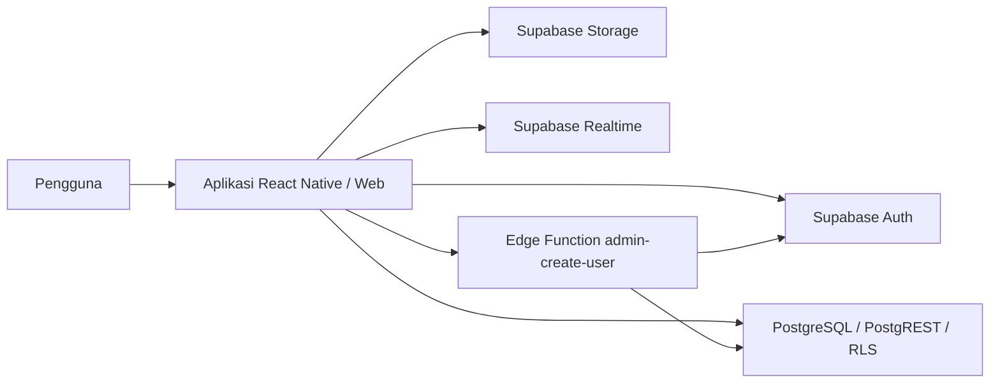

# C4 Model

## Konteks dan container

GSI One melayani admin, marketing, engineer, dan klien melalui Android, iOS, serta web. Data bisnis berada di Supabase.

Kredensial privileged hanya digunakan pada Edge Function. Repository dan service aplikasi memakai sesi pengguna. Migrasi dan seed disimpan di `supabase/`.
