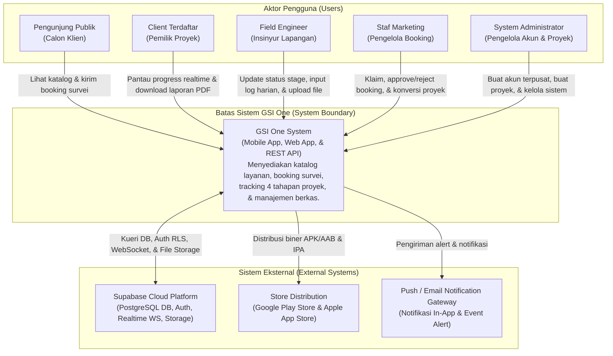
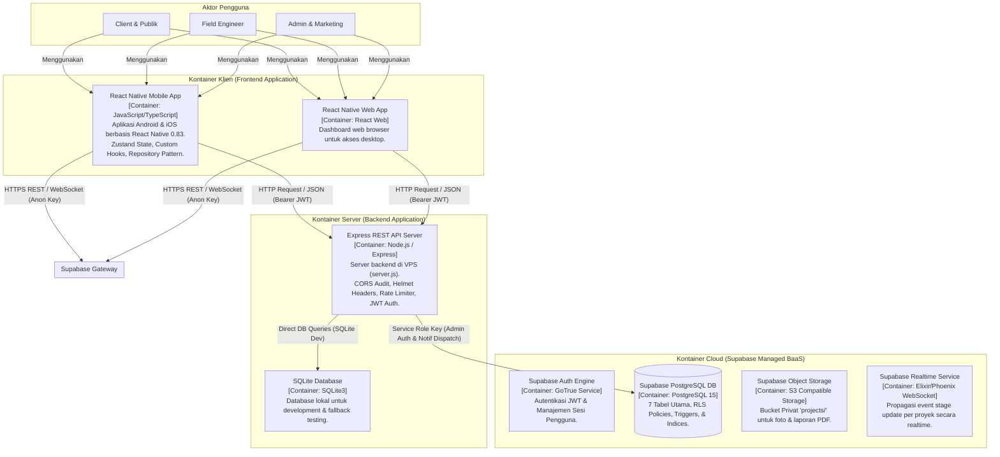

# C4 Architecture Model Specification
## Proyek: GSI One Mobile Application & Express Backend API
## Standar: C4 Model (Context & Container Levels)

---

## 1. C4 Level 1: System Context Diagram

Diagram System Context memvisualisasikan batas ekosistem perangkat lunak GSI One, aktor yang terlibat, serta sistem eksternal yang terhubung.

---

## 2. C4 Level 2: Container Diagram

Diagram Container memvisualisasikan arsitektur kontainer internal aplikasi (Mobile React Native, Web App, Express REST Backend, Supabase Auth, PostgreSQL DB, dan Storage Bucket).

