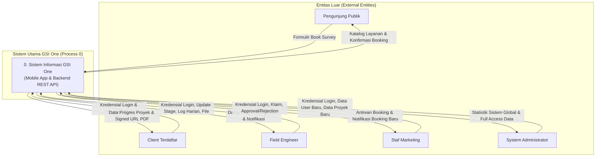
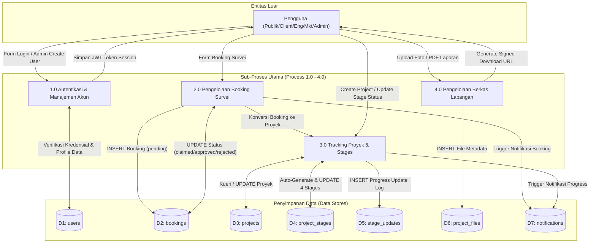

# Data Flow Diagram (DFD) Specification
## Proyek: GSI One Mobile Application & Express Backend API

---

## 1. DFD Level 0 (Context Diagram)

Diagram konteks memvisualisasikan seluruh masukan data dari entitas luar (Publik, Klien, Engineer, Marketing, Admin) ke dalam Sistem GSI One dan keluaran data yang dihasilkan.

---

## 2. DFD Level 1 (Process Diagram)

Diagram DFD Level 1 mempecah Sistem GSI One menjadi 4 sub-proses utama dan aliran data ke database (*data store*).

