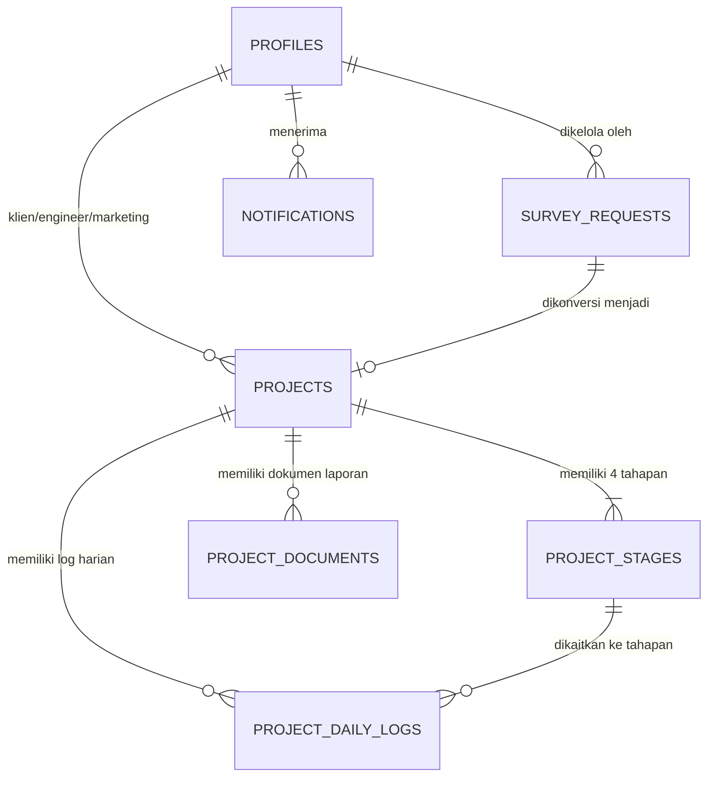

# Database Design Specification
## Proyek: GSI One Mobile Application
## Engine: Supabase PostgreSQL (Row Level Security Active)

---

## 1. Ikhtisar Skema Database

Database GSI One dibangun di atas **Supabase PostgreSQL** dengan tipe data terpusat terverifikasi ketat (`src/types/database.types.ts`). Seluruh akses tabel dilindungi oleh **Row Level Security (RLS)** berbasis *role* (`admin`, `marketing`, `field_engineer`, `client`).

---

## 2. Struktur Tabel Utama

### 2.1 Tabel `profiles` (Manajemen Akun Pengguna)
| Kolom | Tipe Data | Constraint / Default | Keterangan |
| --- | --- | --- | --- |
| `id` | `UUID` | `PK`, `FK (auth.users)` | Identifier unik pengguna dari Supabase Auth |
| `email` | `TEXT` | `NOT NULL`, `UNIQUE` | Email resmi pengguna |
| `full_name` | `TEXT` | `NOT NULL` | Nama lengkap pengguna |
| `ticket_number` | `TEXT` | `UNIQUE` | Nomor tiket login khusus Klien / Staf GSI |
| `role` | `TEXT` | `NOT NULL`, Check Enum | Role: `admin`, `marketing`, `field_engineer`, `client` |
| `phone_number` | `TEXT` | `NULLABLE` | Nomor kontak telepon / WhatsApp |
| `created_at` | `TIMESTAMPTZ` | `NOW()` | Tanggal pendaftaran akun |
| `updated_at` | `TIMESTAMPTZ` | `NOW()` | Tanggal terakhir pembaruan profil |

### 2.2 Tabel `bookings` (Antrean Permohonan Survei Lokasi)
| Kolom | Tipe Data | Constraint / Default | Keterangan |
| --- | --- | --- | --- |
| `id` | `UUID / BIGINT` | `PK`, `DEFAULT gen_random_uuid()` | Identifier unik permohonan |
| `full_name` | `TEXT` | `NOT NULL` | Nama lengkap pemesan survei |
| `company_name` | `TEXT` | `NULLABLE` | Nama perusahaan pemesan |
| `email` | `TEXT` | `NOT NULL` | Email pemesan |
| `phone` | `TEXT` | `NOT NULL` | Nomor telepon pemesan |
| `service_type` | `TEXT` | `NOT NULL` | Layanan yang dipesan (misal: NDT, SHMS, Structural Audit) |
| `location` | `TEXT` | `NOT NULL` | Lokasi objek survei |
| `preferred_date` | `DATE` | `NOT NULL` | Tanggal usulan survei |
| `structure_info` | `TEXT` | `NULLABLE` | Deskripsi spesifikasi objek bangunan |
| `message` | `TEXT` | `NULLABLE` | Catatan tambahan pemesan |
| `status` | `TEXT` | `DEFAULT 'pending'`, Check | Status: `pending`, `claimed`, `approved`, `rejected` |
| `claimed_by` | `TEXT` | `NULLABLE` | Nama staf Marketing / Admin yang menghubungi |
| `claimed_at` | `TIMESTAMPTZ` | `NULLABLE` | Tanggal/Waktu permohonan dihubungi |
| `assigned_to` | `UUID` | `NULLABLE`, `FK (profiles.id)` | ID Staf Marketing / Admin yang mengklaim |
| `rejection_reason` | `TEXT` | `NULLABLE` | Alasan jika permohonan ditolak |
| `created_at` | `TIMESTAMPTZ` | `NOW()` | Waktu pengiriman permohonan |

### 2.3 Tabel `projects` (Data Utama Proyek Teknis)
| Kolom | Tipe Data | Constraint / Default | Keterangan |
| --- | --- | --- | --- |
| `id` | `UUID / BIGINT` | `PK`, `DEFAULT gen_random_uuid()` | Identifier unik proyek |
| `project_code` | `TEXT` | `NOT NULL`, `UNIQUE` | Kode unik proyek (misal: `PRJ-2026-001`) |
| `name` | `TEXT` | `NOT NULL` | Nama proyek inspeksi / audit |
| `client_id` | `UUID` | `NOT NULL`, `FK (profiles.id)` | Identifier Klien pemilik proyek |
| `marketing_id` | `UUID` | `NULLABLE`, `FK (profiles.id)` | Identifier Staf Marketing penanggung jawab |
| `service_type` | `TEXT` | `NOT NULL` | Jenis layanan proyek |
| `location` | `TEXT` | `NOT NULL` | Alamat / lokasi pelaksanaan proyek |
| `status` | `TEXT` | `DEFAULT 'in_progress'`, Check | Status: `draft`, `in_progress`, `completed`, `cancelled` |
| `progress_percentage` | `INT` | `DEFAULT 0`, Check (0-100) | Persentase kemajuan total proyek |
| `assigned_engineer_id` | `UUID` | `NULLABLE`, `FK (profiles.id)` | ID Field Engineer penanggung jawab |
| `booking_id` | `UUID` | `NULLABLE`, `FK (bookings.id)` | ID permohonan survei asal konversi |
| `start_date` | `DATE` | `NOT NULL` | Tanggal mulai proyek |
| `end_date` | `DATE` | `NULLABLE` | Tanggal estimasi / selesai proyek |
| `created_at` | `TIMESTAMPTZ` | `NOW()` | Tanggal pembuatan proyek |

### 2.4 Tabel `project_stages` (Linimasa 4 Tahapan Standar Proyek)
| Kolom | Tipe Data | Constraint / Default | Keterangan |
| --- | --- | --- | --- |
| `id` | `UUID / BIGINT` | `PK`, `DEFAULT gen_random_uuid()` | Identifier unik tahapan |
| `project_id` | `UUID / BIGINT` | `NOT NULL`, `FK (projects.id)` | Foreign key ke proyek induk |
| `stage_name` | `TEXT` | `NOT NULL` | Nama tahapan (Inisiasi, Survei, Analisis, Selesai) |
| `sequence` | `INT` | `NOT NULL` | Urutan tahapan (1, 2, 3, 4) |
| `status` | `TEXT` | `DEFAULT 'pending'`, Check | Status: `pending`, `in_progress`, `done` |
| `progress_percentage` | `INT` | `DEFAULT 0` | Persentase kemajuan tahapan ini |
| `updated_at` | `TIMESTAMPTZ` | `NOW()` | Waktu pembaruan terakhir |

### 2.5 Tabel `stage_updates` (Catatan Progres Pekerjaan Lapangan)
| Kolom | Tipe Data | Constraint / Default | Keterangan |
| --- | --- | --- | --- |
| `id` | `UUID / BIGINT` | `PK`, `DEFAULT gen_random_uuid()` | Identifier entri log |
| `project_id` | `UUID / BIGINT` | `NOT NULL`, `FK (projects.id)` | Foreign key ke proyek |
| `stage_id` | `UUID / BIGINT` | `NULLABLE`, `FK (project_stages.id)` | Foreign key ke tahapan spesifik |
| `created_by` | `UUID` | `NOT NULL`, `FK (profiles.id)` | ID Engineer / Admin pembuat log |
| `log_date` | `DATE` | `NOT NULL` | Tanggal aktivitas lapangan |
| `activity_summary` | `TEXT` | `NOT NULL` | Ringkasan pekerjaan yang dilakukan |
| `issues_notes` | `TEXT` | `NULLABLE` | Catatan kendala / masalah di lapangan |
| `created_at` | `TIMESTAMPTZ` | `NOW()` | Waktu pembuatan entri |

### 2.6 Tabel `project_files` (Metadata Berkas & Laporan PDF)
| Kolom | Tipe Data | Constraint / Default | Keterangan |
| --- | --- | --- | --- |
| `id` | `UUID / BIGINT` | `PK`, `DEFAULT gen_random_uuid()` | Identifier file metadata |
| `project_id` | `UUID / BIGINT` | `NOT NULL`, `FK (projects.id)` | Foreign key ke proyek |
| `uploaded_by` | `UUID` | `NOT NULL`, `FK (profiles.id)` | ID pengunggah berkas |
| `file_name` | `TEXT` | `NOT NULL` | Nama asli berkas |
| `file_path` / `file_url` | `TEXT` | `NOT NULL` | Path / URL berkas di Supabase Storage (`projects/`) |
| `file_type` | `TEXT` | `NOT NULL` | Mime type / kategori (`pdf`, `image`, `report`) |
| `file_size` | `INT` | `NULLABLE` | Ukuran file dalam bytes |
| `description` | `TEXT` | `NULLABLE` | Deskripsi isi dokumen / foto |
| `created_at` | `TIMESTAMPTZ` | `NOW()` | Waktu pengunggahan |

### 2.7 Tabel `notifications` (Sistem Notifikasi Pengguna & Target Role)
| Kolom | Tipe Data | Constraint / Default | Keterangan |
| --- | --- | --- | --- |
| `id` | `UUID` | `PK`, `DEFAULT gen_random_uuid()` | Identifier unik notifikasi |
| `user_id` | `UUID` | `NULLABLE`, `FK (users.id)` | ID pengguna penerima notifikasi spesifik |
| `target_role` | `VARCHAR(50)` | `NULLABLE` | Peran target (`admin`, `marketing`, `engineer`, `client`) |
| `title` | `VARCHAR(255)` | `NOT NULL` | Judul pesan notifikasi |
| `message` | `TEXT` | `NOT NULL` | Isi ringkasan pesan notifikasi |
| `type` | `VARCHAR(50)` | `NOT NULL` | Kategori event (misal: `book_survey`, `stage_updated`) |
| `reference_id` | `TEXT` | `NULLABLE` | ID referensi entitas terkait |
| `is_read` | `BOOLEAN` | `DEFAULT false` | Status penanda telah dibaca |
| `created_at` | `TIMESTAMPTZ` | `NOW()` | Tanggal & waktu notifikasi dikirim |

---

## 3. Diagram Hubungan Entitas (ERD Diagram)

---

## 4. Keamanan Row Level Security (RLS)

1. `profiles`:
   - Admin memiliki akses `ALL` (Select, Insert, Update, Delete).
   - Pengguna non-admin hanya dapat membaca data profil miliknya atau profil publik tim proyek.
2. `bookings`:
   - Publik dapat melakukan `INSERT` (Book Survey).
   - Admin dan Marketing memiliki akses `SELECT` & `UPDATE` (klaim, setuju, tolak, hubungi).
3. `projects` & `project_stages`:
   - Client dapat `SELECT` proyek dan tahapan jika `client_id = auth.uid()` atau `client_name = (SELECT name FROM public.users WHERE id = auth.uid())` atau `created_by = auth.uid()`.
   - Field Engineer dapat `SELECT` & `UPDATE` jika `engineer_id = auth.uid()` atau `created_by = auth.uid()`.
   - Staf Marketing dapat `SELECT` proyek jika `marketing_id = auth.uid()` atau `created_by = auth.uid()`.
   - Admin dan Staff dapat `ALL`.
4. `stage_updates` & `project_files`:
   - Field Engineer & Admin dapat `INSERT`, `UPDATE`, `SELECT`.
   - Client dapat `SELECT` untuk proyek miliknya (`client_id = auth.uid()`).
5. `notifications`:
   - Pengguna dapat `SELECT` & `UPDATE` notifikasi jika `user_id = auth.uid()` atau `target_role = user.role` atau `target_role IS NULL`.
   - Seluruh pengguna ter-otentikasi dapat `INSERT` notifikasi sistem.

---

## 5. Triggers & Database Functions

1. **`handle_new_user()` Trigger**:
   - **Tabel**: `auth.users` -> `public.users`
   - **Fungsi**: Secara otomatis membuat entri profil di `public.users` dengan role bawaan `'client'` saat akun baru terdaftar.

2. **`sync_user_name_changes()` Trigger**:
   - **Tabel**: `public.users` -> `public.projects`
   - **Fungsi**: Secara otomatis mensinkronkan `projects.client_name = NEW.name` untuk seluruh proyek terkait (`client_id = NEW.id`) ketika nama pengguna diubah pada tabel `users`.

