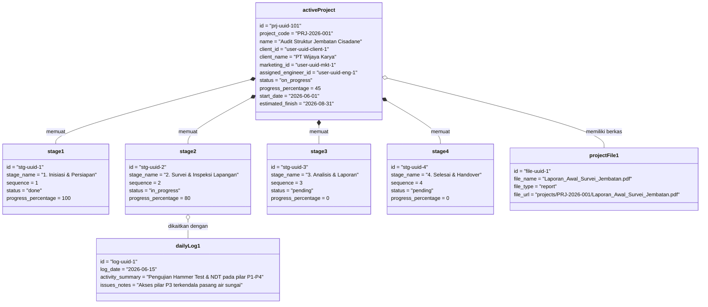

# UML: Object Diagram Specification
## Proyek: GSI One Mobile Application & Supabase

Diagram Object memvisualisasikan snapshot memory instance nyata dari entitas proyek, tahapan, log harian, dan dokumen terhubung pada saat runtime aplikasi.

