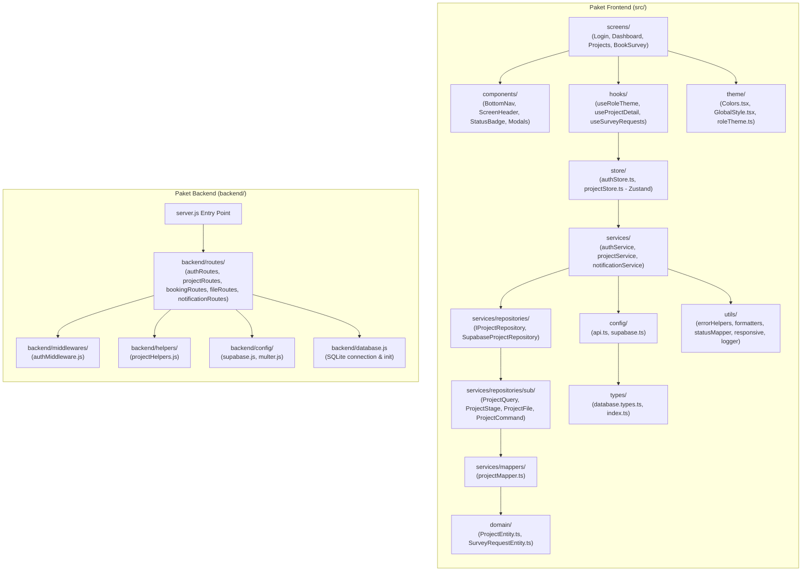

# UML: Package Diagram Specification
## Proyek: GSI One Mobile Application & Express Backend API

Diagram Package memvisualisasikan pengorganisasian modul, direktori paket kode, dan ketergantungan antar-paket pada aplikasi frontend React Native dan backend Express.

