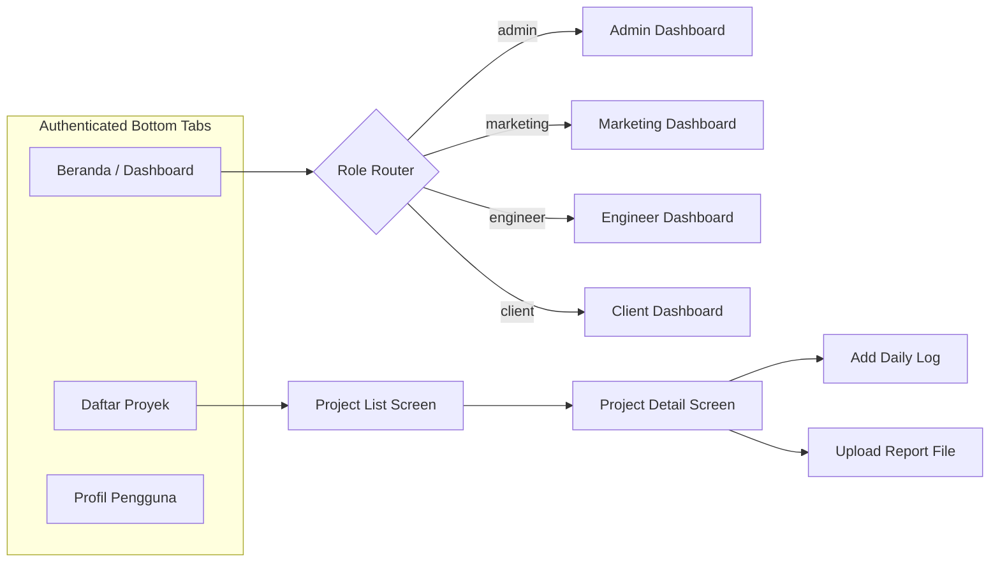

# UI/UX Design Specification & System Architecture
## Proyek: GSI One Mobile Application

---

## 1. Prinsip Desain & Aesthetics

Aplikasi **GSI One Mobile** memadukan estetika modern premium dengan keandalan visual standar industri teknik sipil & inspeksi struktur. Bahasa desain difokuskan pada keterbacaan data yang tinggi, hierarki visual jelas, responsivitas dinamis lintas perangkat, serta skema warna berbasis peran pengguna (*Role-based Color Palette*).

---

## 2. Design Tokens & Design System

### 2.1 Palet Warna Terpusat (`src/src/theme/colors.ts`)
- **Primary Color (Navy GSI)**: `#0F172A` / `#1E293B` - Memberikan kesan profesional, kokoh, dan tepercaya.
- **Secondary Color (Gold / Amber GSI)**: `#D97706` / `#F59E0B` - Aksen warna industri inspeksi dan highlighting.
- **Role-based Accent Gradients**:
  - **Admin**: Gradient Slate/Dark (`#0F172A` ke `#334155`) - Melambangkan otoritas sistem.
  - **Marketing**: Gradient Emerald/Teal (`#059669` ke `#10B981`) - Melambangkan pertumbuhan dan peluang bisnis.
  - **Field Engineer**: Gradient Amber/Orange (`#D97706` ke `#F59E0B`) - Melambangkan kewaspadaan operasional lapangan.
  - **Client**: Gradient Blue/Indigo (`#2563EB` ke `#3B82F6`) - Melambangkan kejelasan dan kenyamanan layanan.

### 2.2 Geometri & Corner Radius Asimetris (`src/src/theme/globalStyles.ts`)
- **Card Asymmetric Radius**: Sudut kanan atas dan kiri bawah `20px`, sudut kiri atas dan kanan bawah `6px` untuk memberikan sentuhan identitas visual modern khas GSI.
- **Elevasi & Shadow**: Soft Drop Shadows (`shadowOpacity: 0.08`, `elevation: 4` hingga `12`).

### 2.3 Sistem Scaling Responsif (`src/utils/responsive.ts`)
- Baselines acuan 390px (standar iPhone 14 & mayoritas layar smartphone Android).
- Helper `wp(percent)`, `hp(percent)`, `moderateScale(size)` menjamin tampilan konsisten di ponsel berukuran kecil hingga tablet.

---

## 3. Komponen UI Reusable Kunci

1. **`ScreenHeader.tsx`**: Header dinamis berpindah warna gradient sesuai `useRoleTheme()` dari role pengguna aktif, lengkap dengan tombol kembali dan judul halaman.
2. **`StatusBadge.tsx`**: Komponen badge dengan warna dinamis berbasis `statusMapper.ts` untuk menampilkan status proyek (`in_progress`, `completed`), status tahapan (`pending`, `done`), dan status permohonan survei (`claimed`, `approved`, `rejected`).
3. **`StageTimeline.tsx`**: Visualisasi linimasa 4 tahapan proyek dengan penanda lingkaran status, garis penghubung, dan indikator persentase.
4. **`SkeletonBox.tsx` & Loading Skeletons**: Loader animasi halus saat memuat data dari Supabase DB untuk mencegah pergeseran tata letak (layout shift).

---

## 4. Alur Layar & Layout Antarmuka Utama

### 4.1 Dashboard Multi-Role Layout
- **Admin Dashboard**: Card metrik statistik 4 kolom, Tombol Aksi Cepat 3-Grid (Buat Akun, Buat Proyek, Permohonan Survei), Widget Proyek Aktif Terbaru, Widget Antrean Permohonan Survei.
- **Marketing Dashboard**: Card Ringkasan Permohonan Survei, Antrean Klaim, dan Tombol Pintas Manajemen Survei.
- **Engineer Dashboard**: Daftar Proyek Ditugaskan, Tombol Cepat Update Progres, dan Form Cepat Input Log Harian Pekerjaan Lapangan.
- **Client Dashboard**: Progress Bar Total Proyek Klien, Widget Health Sensor Status SHMS, Daftar Berkas Laporan PDF yang Siap Diunduh.

### 4.2 Layar Detail Layanan & Book Survey Layout
- **LayananDetailScreen**: Banner Hero dengan latar ilustrasi teknis, Kartu Peringatan Risiko Structure Failure, Kartu Solusi & Manfaat GSI, dan Tombol CTA "Pesan Survei Sekarang".
- **BookSurveyScreen**: Form Isian Bersih berurutan (Informasi Pemesan -> Spesifikasi Struktur -> Pilih Jadwal & Layanan -> Catatan -> Tombol Submit).
