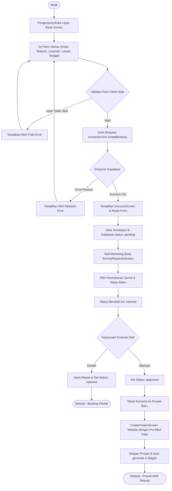
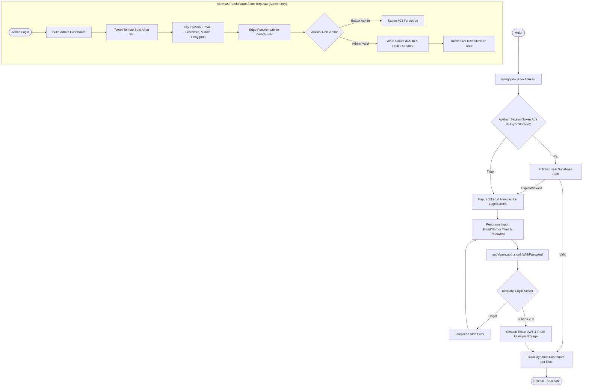
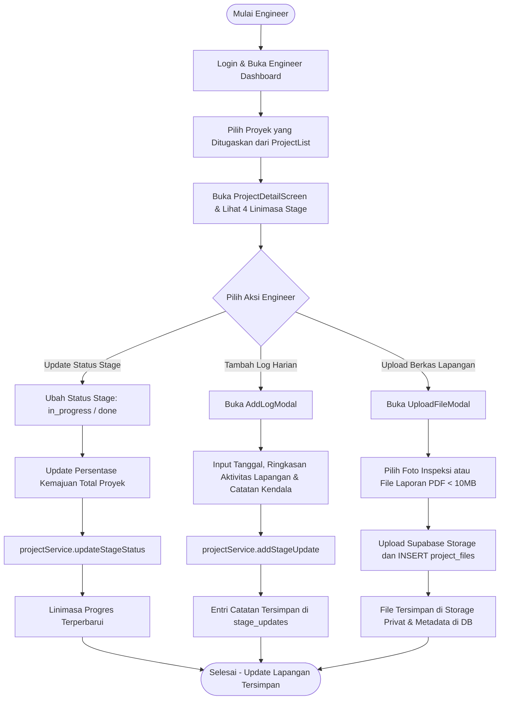

# UML: Activity Diagrams
## Proyek: GSI One Mobile Application & Supabase

---

## 1. Activity Diagram: Alur Pemesanan Survei & Pipeline Marketing

---

## 2. Activity Diagram: Alur Login Admin-Only Account Creation

---

## 3. Activity Diagram: Alur Pembaruan Tahapan & Input Log Lapangan (Engineer)

