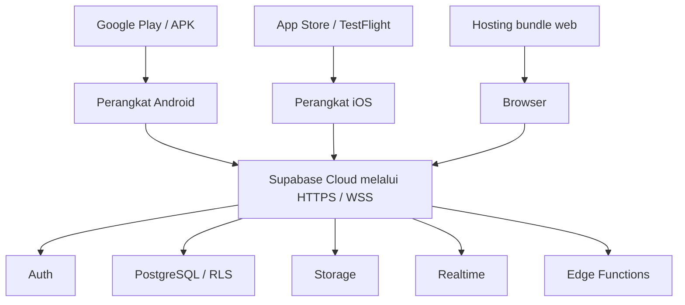

# UML: Deployment Diagram

Aplikasi tidak memerlukan proses server lokal tambahan. Prosedur deployment mencakup migrasi Supabase, Edge Function, konfigurasi environment client, serta distribusi bundle mobile/web.
