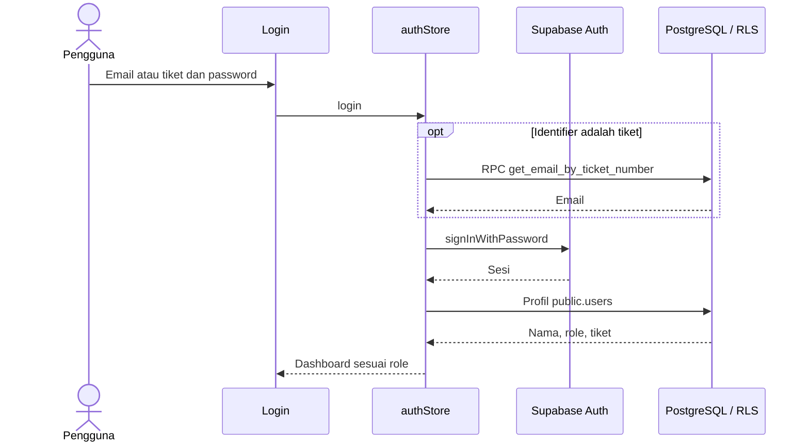
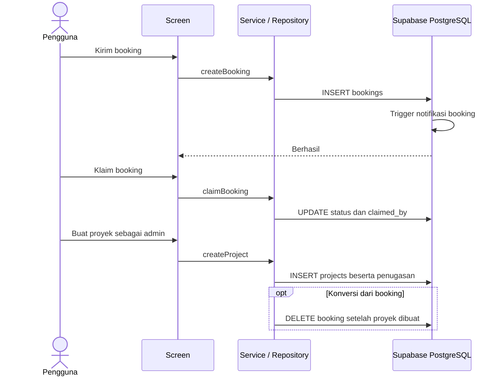

# UML: Sequence Diagrams

## Login

## Booking dan proyek

## Berkas dan realtime

Upload mengirim konten ke Storage dan kemudian mencatat metadata di `project_files`. Perubahan proyek, tahapan, serta catatan diterima oleh subscription pada detail proyek dan memicu pemuatan ulang. Kedua operasi upload/metadata belum berada dalam satu transaksi.
