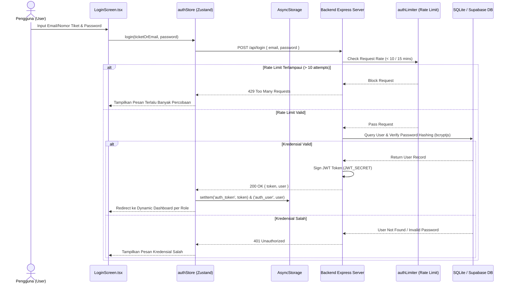
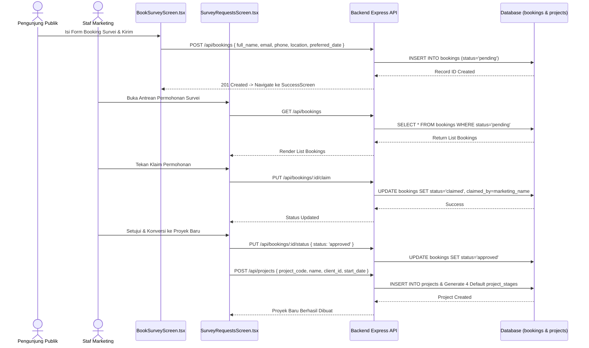
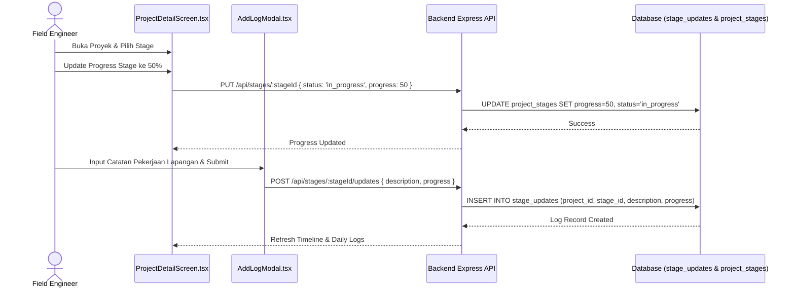
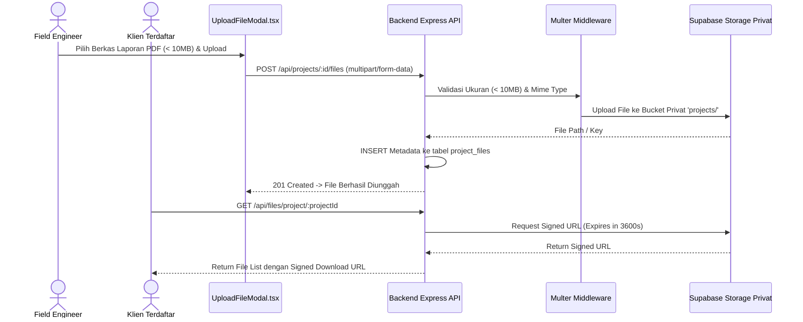

# UML: Sequence Diagrams
## Proyek: GSI One Mobile Application & Express Backend API

---

## 1. Sequence Diagram: Alur Autentikasi Login JWT & Rate Limiting

---

## 2. Sequence Diagram: Alur Booking Survei & Konversi ke Proyek

---

## 3. Sequence Diagram: Pembaruan Stage & Input Log Harian (Field Engineer)

---

## 4. Sequence Diagram: Upload Berkas Inspeksi & Signed URL Privat

