# CI/CD Guide
## Proyek: GSI One Mobile Application

## Status saat ini

Continuous Integration telah diimplementasikan melalui `.github/workflows/ci.yml`. Continuous Deployment untuk Android/iOS masih merupakan proses terpisah dan belum otomatis.

## CI Quality Gate

Workflow bernama **CI Quality Gate** berjalan pada `push` dan `pull_request` untuk branch `main`, `master`, `dev`, dan `develop`.

1. Checkout kode dan menyiapkan Node.js 20 dengan cache npm.
2. Menginstal dependency reproduktif menggunakan `npm ci`.
3. Menjalankan `npm run lint`.
4. Menjalankan `npm run typecheck` (`tsc --noEmit`).
5. Menjalankan `npm run test:ci` (Jest mode CI).

Pull request harus melewati seluruh langkah ini sebelum digabungkan. Build Android/iOS belum dimasukkan karena membutuhkan pengelolaan SDK, signing key, dan secret distribusi yang terpisah.

## CD yang direncanakan

Setelah CI hijau dan migrasi Supabase telah diterapkan di staging:

1. Build AAB/IPA dengan kredensial signing yang tersimpan di secret manager.
2. Distribusikan ke kanal internal untuk QA.
3. Catat hasil SLO dan regression test.
4. Promosikan rilis yang disetujui ke Google Play/App Store.

Jangan menyertakan service-role key, password database, atau keystore dalam workflow atau artefak build.

---

## 3. Diagram Alur Kerja CI/CD Pipeline (GitHub Actions Flow)

```mermaid
flowchart LR
    subgraph TriggerEvent["Trigger Event"]
        Push[Push ke main/develop]
        PR[Pull Request Submit]
    end

    subgraph CIJobs["GitHub Actions CI Quality Gate (.github/workflows/ci.yml)"]
        Setup["1. Checkout & Setup Node.js v20"]
        Install["2. Install Dependensi (npm ci)"]
        Lint["3. Static Analysis (npm run lint)"]
        Typecheck["4. Strict Typecheck (npx tsc --noEmit)"]
        Test["5. Automated Tests (npm run test:ci)"]
    end

    subgraph ApprovalGate["Quality Gate Approval"]
        Result{Semua Checks Passed?}
    end

    subgraph CDJobs["Prosedur Release & Deployment (CD)"]
        BuildAndroid["Build Release AAB/APK (Gradle)"]
        DeploySupabase["Terapkan migrasi dan deploy Edge Function"]
        PlayStore["Rollout Google Play Closed Testing"]
    end

    Push & PR --> Setup
    Setup --> Install
    Install --> Lint
    Lint --> Typecheck
    Typecheck --> Test
    Test --> Result

    Result -->|Gagal| Block[Block Merge / Notify Dev]
    Result -->|Lulus| Merge[Merge PR ke main]
    Merge --> BuildAndroid & DeploySupabase
    BuildAndroid --> PlayStore
```

