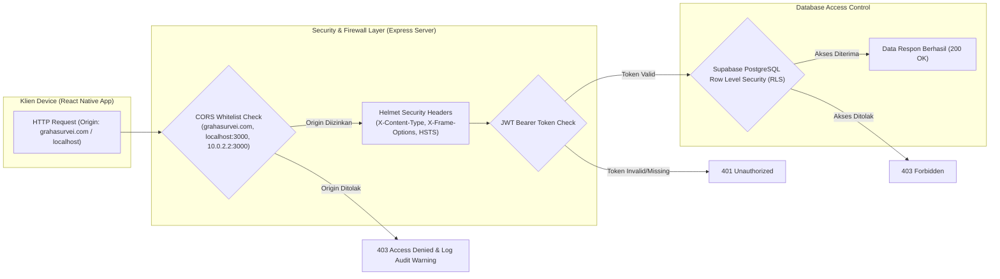

# Environment Configuration
## Proyek: GSI One Mobile Application

---

## 1. Environment yang Digunakan

| Environment | Tujuan                        | API Base URL                             |
| ----------- | ----------------------------- | ---------------------------------------- |
| Development | Pengembangan lokal (Emulator) | `http://10.0.2.2:3000` (Android emulator)|
| Development | Pengembangan lokal (Simulator)| `http://localhost:3000` (iOS/Web)        |
| Production  | Rilis ke Play Store/App Store | `https://grahasurvei.com`                |

Perpindahan environment dilakukan melalui `APP_ENV` dan `API_BASE_URL_EMULATOR`, `API_BASE_URL_SIMULATOR`, serta `API_BASE_URL_PRODUCTION`. `src/config/api.ts` memilih URL secara dinamis: `production`, `simulator`, atau default emulator Android.

---

## 2. Manajemen File Environment Variables

Proyek menggunakan dua file `.env` yang **tidak boleh di-commit ke Git**:

### Frontend: `.env` (root project)

Berisi variabel konfigurasi yang digunakan oleh aplikasi React Native melalui file `src/config/supabase.ts`:

| Variabel               | Keterangan                              |
| ---------------------- | --------------------------------------- |
| `SUPABASE_URL`         | URL project Supabase Cloud              |
| `SUPABASE_ANON_KEY`    | Anon/Public API Key Supabase            |
| `APP_ENV`              | `development`, `simulator`, atau `production` |
| `API_BASE_URL_EMULATOR` | Base URL backend untuk Android emulator |
| `API_BASE_URL_SIMULATOR` | Base URL backend untuk iOS/Web lokal |
| `API_BASE_URL_PRODUCTION` | Base URL backend produksi |

### Backend: `backend/.env`

Berisi variabel konfigurasi server Node.js/Express:

| Variabel                 | Keterangan                                      | Wajib? |
| ------------------------ | ----------------------------------------------- | ------ |
| `JWT_SECRET`             | Secret key untuk signing JWT token autentikasi  | Ya     |
| `PORT`                   | Port server (default: 3000)                     | Tidak  |
| `SUPABASE_URL`           | URL Supabase (jika server menggunakan Supabase) | Tidak  |
| `SUPABASE_SECRET_KEY`    | Service Role Key Supabase (hanya di backend)    | Tidak  |

> **Perhatian**: Variabel `JWT_SECRET` bersifat wajib. Server akan menolak start dan mengeluarkan pesan error jika variabel ini tidak diset.

---

## 3. Setup File .env untuk Developer Baru

```bash
# 1. Salin template frontend
cp .env.example .env

# 2. Salin template backend
cp backend/.env.example backend/.env

# 3. Isi nilai yang sesuai di kedua file .env
# (minta nilai dari Lead Developer atau password manager tim)
```

---

## 4. Konfigurasi Android

File: `android/app/build.gradle`
```gradle
android {
    defaultConfig {
        applicationId "com.gsione"
        minSdkVersion 21
        targetSdkVersion 34
        versionCode 1
        versionName "1.0.0"
    }
}
```

Keystore untuk signing release dikelola secara terpisah dan **tidak disimpan di repositori Git**.

---

## 5. Konfigurasi iOS

File: `ios/gsione/Info.plist`
- Bundle Identifier: `com.gsione`
- Minimum iOS deployment target: 13.0
- NSAppTransportSecurity: Dikonfigurasi untuk mengizinkan HTTPS production.

---

## 6. Aturan Keamanan

- File `.env` dan `backend/.env` sudah tercantum di `.gitignore` dan tidak akan ter-commit.
- Gunakan `.env.example` dan `backend/.env.example` sebagai template yang aman untuk di-commit.
- Tidak boleh ada nilai secret atau API key yang ditulis langsung (hardcode) di file source code.
- Bucket `projects` harus tetap privat. Aplikasi memakai anon key untuk meminta signed URL; `SUPABASE_SECRET_KEY` hanya boleh berada di backend/secret manager.
- Untuk generate `JWT_SECRET` yang aman, jalankan:
  ```bash
  node -e "console.log(require('crypto').randomBytes(64).toString('hex'))"
  ```

---

## 7. Panduan Migrasi Endpoint: Serverless ke VPS

Jika aplikasi berpindah dari arsitektur **Serverless / Supabase Cloud** ke **VPS (Virtual Private Server)**, lakukan langkah-langkah penyesuaian berikut pada berkas `src/config/api.ts` dan konfigurasi environment:

### A. Perubahan Variabel Environment (`.env`)
Fungsi `getApiBaseUrl()` pada `src/config/api.ts` membaca URL secara dinamis dari variabel environment. Ubah nilai target di `.env`:
- `API_BASE_URL_PRODUCTION`: Ubah ke domain/IP publik VPS (contoh: `https://api.domainanda.com`).
- `API_BASE_URL_EMULATOR`: Sesuaikan ke URL backend lokal/VPS staging saat pengujian emulator (contoh Android: `http://10.0.2.2:3000` atau port server VPS lokal).

### B. Penyesuaian Path di `API_ENDPOINTS`
Sesuaikan objek `API_ENDPOINTS` pada `src/config/api.ts` dengan skema routing server VPS Anda:
- **REST API VPS (Node.js/Express, Laravel, NestJS):**
  ```typescript
  export const API_ENDPOINTS = {
      BOOKING_MODERN: `${API_BASE_URL}/api/v1/booking`,
      LOGIN_MODERN: `${API_BASE_URL}/api/v1/auth/login`,
      REGISTER_MODERN: `${API_BASE_URL}/api/v1/auth/register`
  };
  ```
- **PHP Native:**
  ```typescript
  export const API_ENDPOINTS = {
      BOOKING: `${API_BASE_URL}/api/booking.php`,
      LOGIN: `${API_BASE_URL}/api/login.php`,
      REGISTER: `${API_BASE_URL}/api/register.php`
  };
  ```

### C. Penyesuaian Pengambilan Data (Service Layer)
- **Supabase Self-Hosted di VPS:** Jika VPS menjalankan Supabase Self-Hosted, cukup perbarui `SUPABASE_URL` dan `SUPABASE_ANON_KEY` di `.env`. File `src/config/supabase.ts` akan otomatis mengarah ke VPS.
- **REST API Custom VPS:** Jika backend diganti total ke REST API VPS, ubah pemanggilan `supabase.from(...)` pada repository/service layer menjadi HTTP Client (`fetch`/`axios`) yang mengarah ke `API_ENDPOINTS`.

### D. Persyaratan Keamanan & SSL
- **HTTPS Mandatory:** Android dan iOS mewajibkan HTTPS untuk koneksi produksi. Pastikan server VPS Anda menggunakan sertifikat SSL aktif (misal Let's Encrypt).
- **JWT Header:** Untuk REST API VPS custom, pastikan menyisipkan header `Authorization: Bearer <token>` pada setiap request terproteksi.

### E. Pertimbangan Arsitektur Fitur & Database (Custom REST API vs Supabase Self-Hosted)

Saat bermigrasi ke VPS, pertimbangkan kebutuhan pembuatan API untuk fitur-fitur pendukung (Database CRUD, Auth, Upload File, dan Notifikasi):

#### 1. Opsi A: Backend Custom REST API (Node.js/Express, Laravel, dll.)
Aplikasi mobile **tidak dapat terhubung langsung** ke database di VPS demi alasan keamanan. Semua interaksi harus dibuatkan endpoint REST API:
- **CRUD Database:** Wajib membuat rute & controller API untuk setiap tabel (Proyek, Stages, Bookings, Profiles, Logs). Contoh rute ada pada `backend/routes/projectRoutes.js` dan `bookingRoutes.js`.
- **Upload & Storage File:** Wajib membuat API upload (seperti `POST /api/files/upload`) yang menyimpan file ke disk VPS (folder `backend/uploads`) atau Cloud Storage eksternal. Contoh di `backend/routes/fileRoutes.js`.
- **Autentikasi & Autorisasi:** Wajib membuat handler login, register, enkripsi password, dan pembuat JWT token (`backend/routes/authRoutes.js`).
- **Push Notification:** Wajib membuat endpoint pendaftaran token perangkat dan trigger integrasi FCM.

#### 2. Opsi B: Supabase Self-Hosted di VPS (Docker)
**Tidak perlu membuat REST API manual satu per satu.**
Container Docker Supabase Self-Hosted mengemas:
- **PostgREST:** Otomatis mengubah skema database PostgreSQL menjadi RESTful API.
- **GoTrue:** Mengelola API autentikasi pengguna secara bawaan.
- **Supabase Storage:** Mengelola upload dan izin file secara bawaan.
- **Dampak Frontend:** Kode pada `src/services/` dan repository layer tidak perlu diubah, cukup perbarui `SUPABASE_URL` di `.env` ke domain VPS Anda.

#### Matriks Perbandingan Ringkas
| Fitur / Operasi | Custom REST API (Node.js/Express) | Supabase Self-Hosted di VPS |
| :--- | :--- | :--- |
| **Operasi Database** | Wajib buat rute & controller API per tabel | Otomatis via SDK Supabase / PostgREST |
| **Autentikasi User** | Wajib buat handler JWT & enkripsi password | Otomatis via Supabase Auth (GoTrue) |
| **Upload File/Foto** | Wajib buat API upload (multer/formidable) | Otomatis via Supabase Storage |
| **Pengubahan di Frontend** | Perlu refactoring dari SDK ke `fetch`/`axios` | Hanya ubah `SUPABASE_URL` di `.env` |

---

## 8. Diagram Alur Jaringan & Keamanan (Network & Security Flow)




